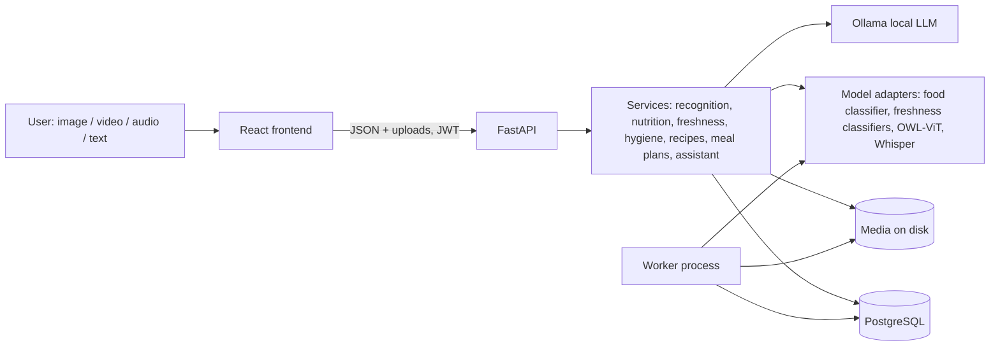

# Architecture

This follows the supplied diagram: *User Input → FastAPI backend ⇄ Data storage*, *AI models (vision + audio + LLM)* generating the four output groups. Additions beyond the diagram, from the master prompt: authentication, a background worker, dashboard/history.

## Layers (backend/app)

| Layer | Where | Rule |
|---|---|---|
| Routes | `api/routes/*` | Thin: validate, authorise, call a service |
| Schemas | `schemas/*` | Pydantic request/response models |
| Services | `services/*` | All business rules and calculations; deterministic |
| Model adapters | `ml/*`, `llm/*` | Interfaces in `ml/base.py`; swap a model by implementing one class |
| Persistence | `db/*` | SQLAlchemy models; Alembic migration in `alembic/versions` |
| Worker | `worker.py` | Postgres-backed queue (`SELECT … FOR UPDATE SKIP LOCKED`); no Redis |

**Principle:** calculations, allergy checks, unit conversions and temporal hygiene decisions are plain code. The LLM only writes text and structured drafts, and every draft is schema-validated and re-checked by code before use.

## Feature flows

| Feature | Flow |
|---|---|
| Recognition | upload → size/format/integrity checks → preprocess → classifier → top-5 with confidence → stored → user can correct label → "analyse nutrition" |
| Nutrition | name (or recognition id) → match DB record (exact, else fuzzy ≥0.72 with the score shown) → per-100 g → portion scaling → unknowns stay `null` → health-score heuristic with shown components |
| Freshness | upload + category → image-quality check → category model (if installed) → class probabilities → below threshold ⇒ `unable_to_determine` → always shows the safety note |
| Hygiene | upload video → validate/read metadata → job `queued` → worker samples frames → detector reports positives only → temporal judge per indicator → evidence frames → report → human review |
| Recipes | request + profile → restriction rules → LLM JSON → schema validation → code check of ingredients **and steps** → retry with feedback → reject if still violating → DB nutrition estimate (matched ingredients only) |
| Meal plans | request → background task: per-day LLM call, per-meal fallback → each meal code-checked → final whole-plan validation → `ready`/`failed` |
| Assistant | text/audio/image+text → intent (rules) → the one relevant service → reply with typed sources |

## Data model

`users`, `user_profiles`, `refresh_tokens`, `media_files`, `analyses` (recognition / nutrition / freshness rows, with model name/version), `nutrition_foods` (per-100 g, NULL = unknown, source + verified flag), `hygiene_jobs`, `hygiene_findings`, `hygiene_reports`, `recipes`, `meal_plans`. Ownership is by `user_id` on every row; every query filters on it.

## API

Interactive docs at `/docs` (OpenAPI, 44 paths). Errors share one shape: `{"error": {"code", "message", "details", "request_id"}}`; `X-Request-ID` is returned on every response.

| Area | Endpoints |
|---|---|
| Auth | `POST /auth/register · login · refresh · logout`, `GET/PATCH/DELETE /users/me…` |
| Recognition | `POST /food/recognize`, `GET /food/recognize/{id}`, `PATCH …/correction` |
| Nutrition | `POST /nutrition/analyze`, `GET /nutrition/{id}` |
| Freshness | `GET /freshness/categories`, `POST /freshness/analyze`, `GET /freshness/{id}` |
| Hygiene | `POST /hygiene/analyze`, `GET /hygiene/jobs[/{id}]`, `POST …/cancel`, `DELETE …/{id}`, `GET /hygiene/reports/{id}`, `PATCH /hygiene/findings/{id}/review` |
| Recipes | `POST /recipes/generate · search`, `GET /recipes[/{id}]`, `POST /{id}/revise · scale · substitute · save` |
| Meal plans | `POST /meal-plans/generate`, `GET /meal-plans[/{id}]`, `PATCH /{id}` (replace slot / feedback), `POST /{id}/shopping-list` |
| Assistant | `POST /assistant/message · audio · multimodal` |
| Other | `GET /history`, `GET /dashboard/summary`, `GET /exports/analysis/{id}`, `GET /exports/hygiene/{id}`, `GET /media/{id}`, `/admin/*` (admin role) |
